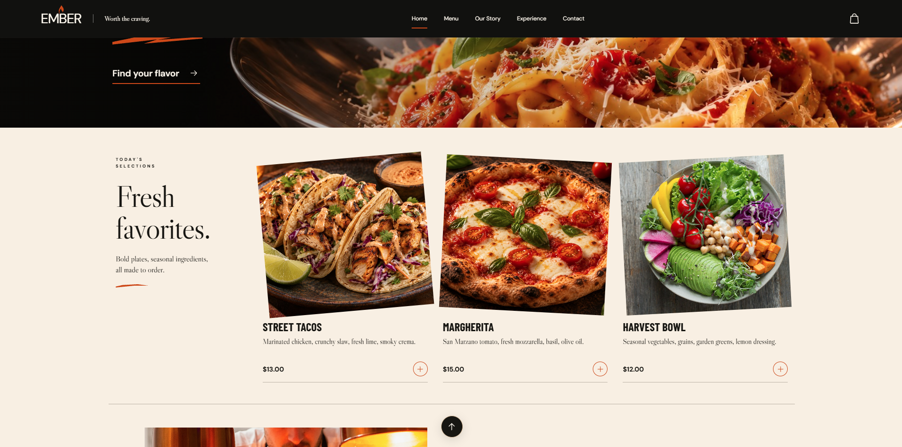
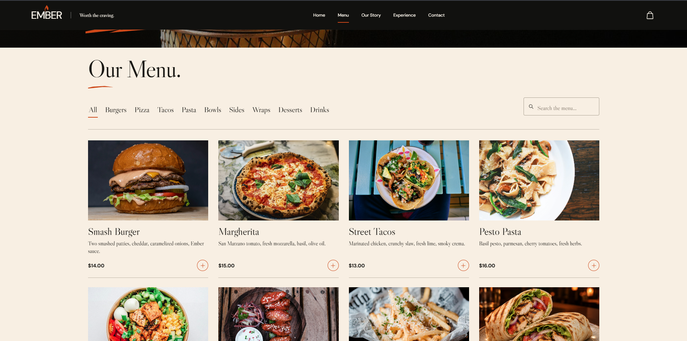
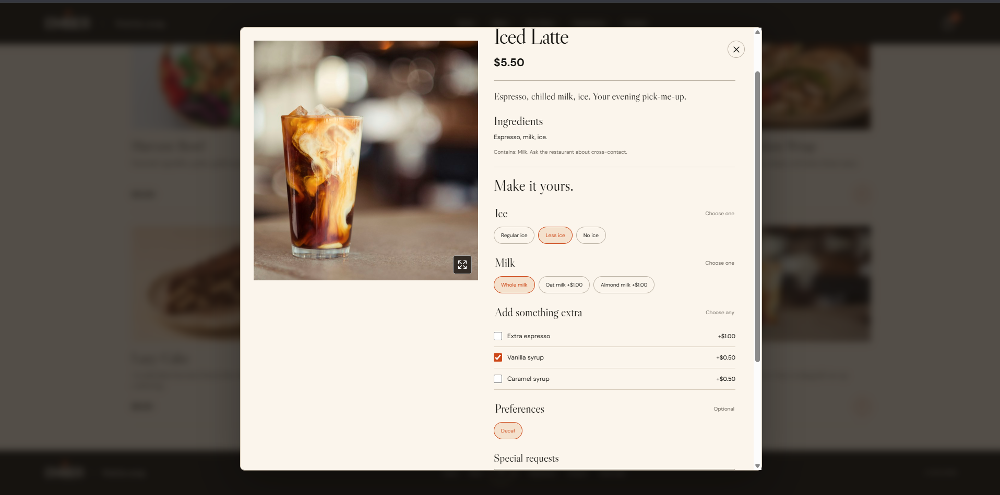
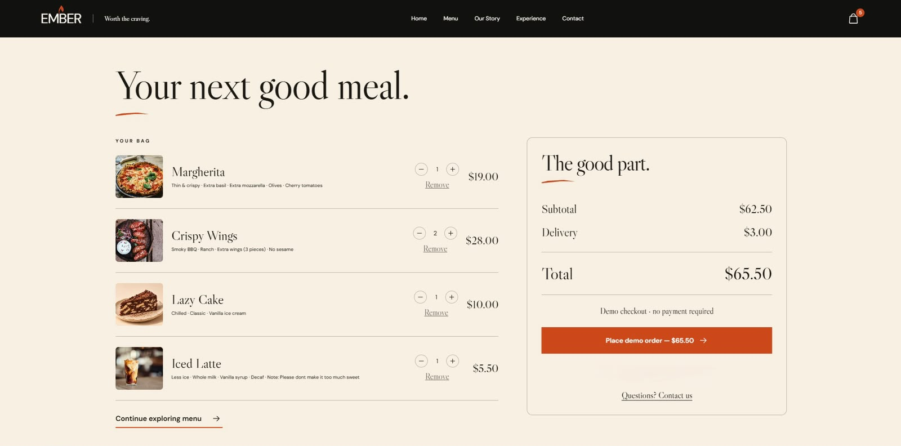
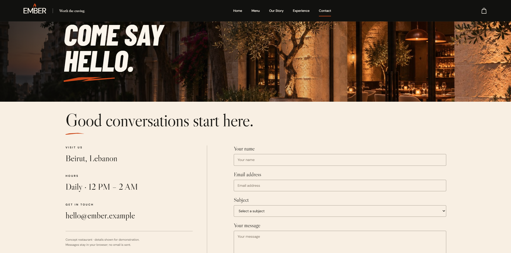
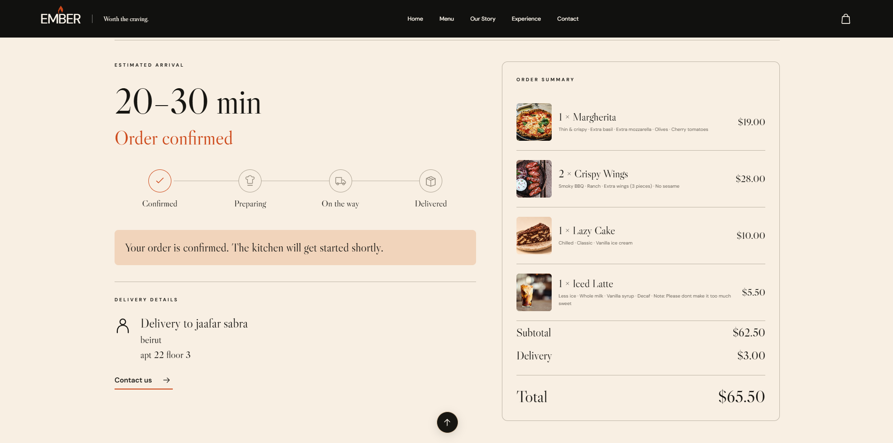
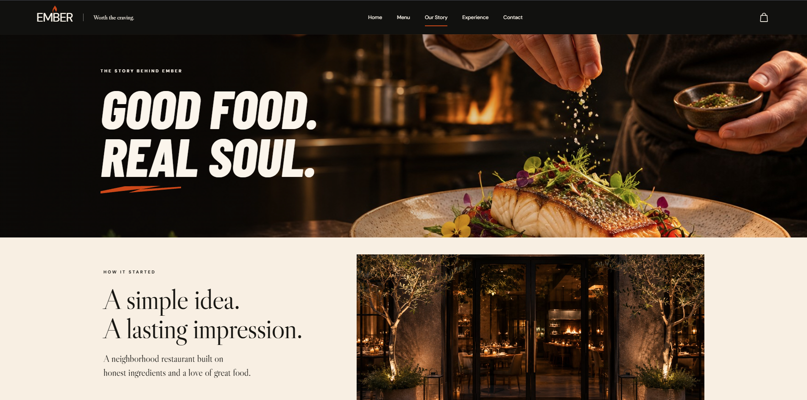
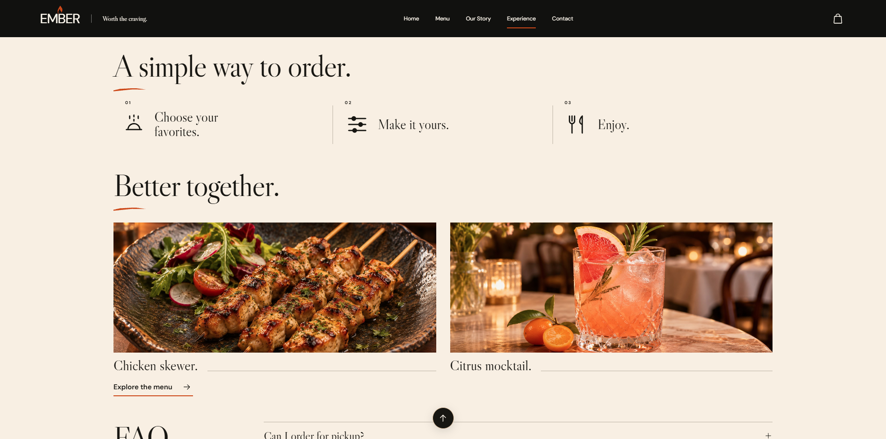

# EMBER - Worth the craving.

## Project description

A responsive restaurant ordering frontend built with React for CSCI426 Advanced Web Programming, Phase 1, at Lebanese International University (LIU).

Customers can browse and search the menu, customize dishes, manage their bag, choose delivery or pickup, and view simulated order tracking. The website includes Home, Our Story, Experience, Menu, Contact, Checkout and Tracking. Cart and order data persist locally in the browser; no real orders, payments or email are transmitted.

**Student:** Jaafar Sabra  
**ID:** 72230515  
**Instructor:** Ghadir Khalil  
**Project mode:** Individual

- **GitHub:** https://github.com/JaafarSabra/EMBER-Restaurant
- **Live website:** https://ember-restaurant-rust.vercel.app/

Design, implementation and documentation used AI assistance. Images combine OpenAI-generated imagery and Unsplash photography. No pre-built website template was used.

## Setup instructions

Install Node.js 20 or later, then run:

```bash
git clone https://github.com/JaafarSabra/EMBER-Restaurant.git
cd EMBER-Restaurant
npm install
npm run dev
```

Open the local URL printed in the terminal.

To create and preview a production build:

```bash
npm run build
npm run preview
```

For Vercel, use the Vite preset, build command `npm run build`, and output directory `dist`. No environment variables are required.

## Screenshots of the UI


Screenshots below were supplied by Jaafar Sabra on 8 November 2026 from the working application. They show actual usage, not design mockups.

| Home                                       | Menu                                       |
| ------------------------------------------ | ------------------------------------------ |
|  |  |

| Customize a dish                                             | Bag and checkout                                   |
| ------------------------------------------------------------ | -------------------------------------------------- |
|  |  |

| Contact                                          | Order tracking                                     |
| ------------------------------------------------ | -------------------------------------------------- |
|  |  |

| Our Story | Experience |
| --- | --- |
|  |  |

